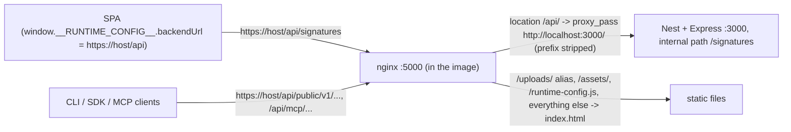

# API route inventory (Phase 0, P0-A and P0-B)

**Measured:** 2026-11-03.
**Repository / branch / worktree:** `cuongtranba/omninoise`, branch `docs/phase-0-typed-api-handoff-20261103`, local worktree `omninoise-phase0`. The application source is identical to `origin/main` at `f6bea7fe` (the PR head before Phase 0, `a2176888`, only added the two handoff documents). The handoff's file list still matches the source; nothing it names has moved.
**How it was produced:** the controllers were parsed with the TypeScript compiler API, the production build was booted locally against a disposable Postgres and its route map and `/docs-json` captured, and the wire behavior was probed with `curl` against that local process. See [openapi-coverage.md](openapi-coverage.md) for the boot commands and [`evidence/api-inventory.mjs`](evidence/api-inventory.mjs) for the script. The full per-route table (245 rows: method, internal path, public URL, surface, auth middleware, guards and policies, body type, static consumers, notes, source line) is [`evidence/api-routes.md`](evidence/api-routes.md).

## 1. URL rewrite: public URL vs internal path

- Production sets `NEXT_PUBLIC_BACKEND_URL=https://${POSTIZ_HOST}/api` (`deploy/compose.yaml`), and `var/docker/nginx.conf` proxies `location /api/` to `http://localhost:3000/` — the trailing slash strips `/api`. So the public URL of every Nest route is `/api` + its internal path, and the backend itself has no `/api` prefix.
- **Measured:** on the backend directly, `GET /api/signatures` answers `404 {"message":"Cannot GET /api/signatures","error":"Not Found","statusCode":404}` while `GET /signatures` answers `200`. Pinned by `apps/backend/src/main.spec.ts`. A future route mounted at `/api/...` inside the backend would be unreachable behind this nginx.
- nginx forwards every request header (it only adds `Host`, `X-Real-IP`, `X-Forwarded-*` and re-sets `Reload`, `Onboarding`, `Activate`, `Auth`, `Showorg`, `Impersonate`, `Accept-Language`); `client_max_body_size 2G`; `/uploads/` is served by nginx from the volume, never by Nest.
- Dokploy adds the domain and Traefik in front of nginx (`deploy/compose.yaml` has no labels by design). Whether Traefik routes any path outside `/api/` to the backend is **unknown** from this repository; see the MCP discovery finding in section 4.

## 2. Counts (reconciled three ways)

| Source | Count |
| --- | --- |
| Handlers parsed from `apps/backend/src/api/routes/*.controller.ts` and `public-api/routes/**` | 245 (245 unique `METHOD path`) |
| Routes Nest mapped at boot (`RouterExplorer` "Mapped {…}" log lines) | 245, identical set |
| Operations in `/docs-json` | 245 on 216 paths, identical set (matched by `operationId` and by method + path) |
| `mcp.parity.spec.ts` decorator parser | 210 web + 35 public = 245, same keys |

By method: GET 105, POST 107, PUT 17, DELETE 16 (no PATCH, no `@All`).

| Surface | Routes | Auth | Notes |
| --- | --- | --- | --- |
| browser-authenticated | 168 | `AuthMiddleware` | the SPA's API: 19 of the 20 controllers in `api.module.ts` `authenticatedController` (the 20th, `OAuthAuthorizedController`, is counted under oauth-server) |
| public-api-v1 (`/public/v1/*`) | 35 | `PublicAuthMiddleware` | versioned API for the CLI, the SDK, the Canva app (CORS origin) and any API-key holder |
| auth-flow (`/auth/*`) | 13 | none | login, register, activation, social sign-in; 7 use `@Res` to set cookies/headers |
| unauthenticated-browser | 11 | none | `PublicController` (preview pages, tracking pixel, media stream, comment by visitor, billing callback) and `NoAuthIntegrationsController` (channel OAuth callback, extension refresh) |
| oauth-server (`/oauth/*`) | 8 | 7 none + 1 `AuthMiddleware` (`OAuthAuthorizedController`) | OAuth 2.0 server for MCP clients and the CLI |
| mcp-widget | 3 | `UploadWidgetAuthMiddleware` / `ClippingWidgetAuthMiddleware` (a `?ticket=` query) | upload and clipping widgets shown inside MCP hosts |
| server-to-server | 3 | none at middleware level, signed partner token in the body | `/enterprise/*` |
| provider-webhook | 2 | none, signature over `req.rawBody` | `POST /stripe`, `POST /payment/:provider` (`rawBody: true` in `main.ts`) |
| health | 2 | none | `GET /` (liveness), `GET /monitor/queue/:name` |

Other route properties, from the parsed handlers:

- 20 handlers write the response themselves with `@Res` (cookies, redirects, streams): the 7 auth-flow ones, `POST /copilot/chat`, `POST /copilot/agent` (CopilotKit runtime streaming), `POST /media/:endpoint` (chunked upload), `GET /oauth/hubspot/callback`, `POST /posts/generator`, `POST /public/t`, `GET /public/stream` (media proxy), and six `/user/*` session routes (impersonate, join-org, change-org, delete-account, logout, t).
- 4 multipart uploads, all `FileInterceptor('file', streamUploadOptions())`: `POST /media/upload-server`, `POST /media/upload-simple`, `POST /media-widget/upload`, `POST /public/v1/upload`.
- Body size: the default Express JSON limit (100 kB) everywhere, except `/posts` and `/copilot/*` which get a 50 MB parser registered in `main.ts` before Nest's own. **Measured:** a 200 kB body to `POST /signatures` → `413`; to `POST /posts` → `400` from validation. Pinned by `main.spec.ts`.
- Rate limits: the global `ThrottlerBehindProxyGuard` only counts `POST /public/v1/posts` (per organization) and `POST /public/posts/:id/comments` (per client IP); `@Throttle` adds explicit limits to `POST /auth/farcaster/signer`, `GET /auth/farcaster/signer`, `POST /oauth/authorize/self-hosted` and `GET /oauth/hubspot/callback`. Storage is Postgres (`PgThrottlerStorage`), limit `API_LIMIT` per hour (30 in production compose).
- Policies: 26 `@CheckPolicies` and 10 `@UseGuards` (super-admin and real-IP throttling) at handler level; `PoliciesGuard` is global and skips any path containing `/auth`, `/integrations/social-connect` or `/integrations/provider`.
- `MCP_ONLY` set in the environment removes every controller except `RootController`, `OAuthController`, `MediaWidgetController`, `ClippingWidgetController` (`api.module.ts`, `public.api.module.ts`). Production does not set it.

## 3. Express routes outside Nest controllers (mounted by `startMcp`)

`libraries/nestjs-libraries/src/chat/start.mcp.ts` calls `app.use(...)` on the Express instance before Nest's pipes and filters are configured. These routes are **not** in the controller parser, the boot route map or OpenAPI.

| Internal path | Public URL | Auth | What it serves |
| --- | --- | --- | --- |
| `/mcp` | `/api/mcp` | `Authorization: Bearer <org API key or pos_ OAuth token>`; `401 Missing Authorization header` (text/html) | streamable-HTTP MCP, full toolset, CORS `*` |
| `/mcp/:id` | `/api/mcp/<apiKey>` | the org API key in the path; `400 Invalid API Key` | same, key in URL |
| `/sse/:id`, `/message/:id` | `/api/sse/<apiKey>`, `/api/message/<apiKey>` | key in path | legacy SSE MCP transport |
| `/mcp-oauth`, `/mcp-oauth-claude`, `/mcp-oauth-chatgpt`, `/mcp-oauth-dynamic` | `/api/...` | OAuth bearer (`pos_` or `psh_` relay token); `401` + `WWW-Authenticate: Bearer resource_metadata=...` | MCP for OAuth clients; the Claude directory path hides media-generation and admin tools |
| `/.well-known/oauth-protected-resource/<resource>` | `/api/.well-known/...` | none | RFC 9728 metadata, only for the four paths above |
| `/.well-known/oauth-authorization-server/<issuer>` | `/api/.well-known/...` | none | RFC 8414 metadata for `/mcp-oauth-chatgpt`, `/mcp-oauth-dynamic`, and `/` when `HUBSPOT_OAUTH_CLIENT_ID` is set |
| `/.well-known/openid-configuration/<issuer>` | `/api/.well-known/...` | none | only when `OPENAI_OAUTH_CLIENT_ID` is set |
| `/.well-known/openai-apps-challenge` | `/api/.well-known/...` | none | only when `OPENAI_APP_CHALLANGE` is set |

Also outside the controllers: `GET /docs` and `GET /docs-json` (Swagger UI and document, `loadSwagger` in `main.ts`), publicly reachable as `/api/docs` and `/api/docs-json`.

## 4. Auth and header matrix

| Mechanism | Request side | Response side | Failure (measured locally) |
| --- | --- | --- | --- |
| `AuthMiddleware` (browser) | `auth` header **or** `auth` cookie (JWT; only the `id` claim is trusted, the user is re-read from the database and must be `activated`); `showorg` header or cookie picks one of the user's organizations; `impersonate` header or cookie only for a super admin | `reload`, `onboarding`, `activate` headers (exposed via CORS) drive SPA navigation | `401`, empty body, `logout: true`, `Set-Cookie: auth=; Max-Age=-1; Domain=<FRONTEND_URL domain>; HttpOnly; Secure; SameSite=None` (the middleware throws `HttpForbiddenException`, which `HttpExceptionFilter` turns into 401). Pinned by `main.spec.ts` |
| Errors inside authentication | `AuthMiddleware` wraps all of its work, including the database lookups, in one `try/catch` that throws `HttpForbiddenException` (`auth.middleware.ts:118-120`) | — | any failure there, a database error included, is answered like a bad session: `401` + `logout: true` + cleared cookie, so the SPA sends the user to `/`. Read from source, not provoked locally. A replacement must decide deliberately whether to keep this |
| Organization boundary | `showorg` naming an organization the user is not in is **ignored**: the request runs as the user's own organization, no 403 | — | **Measured** with two seeded organizations; pinned by `main.spec.ts` |
| `PublicAuthMiddleware` (`/public/v1`) | `Authorization: <raw API key>` or `Authorization: pos_<token>` (no `Bearer`); `x-postiz-org` (super-admin API only), `x-postiz-include-deleted` | JSON bodies | `401 {"msg":"No API Key found"}`, `401 {"msg":"Invalid API key"}`, `401 {"msg":"Invalid OAuth token"}`, `401 {"msg":"No subscription found"}`, `403 {"msg":"Unauthorized"}`. First two pinned by `main.spec.ts` |
| Validation | global `ValidationPipe({ transform: true })` | — | `400 {"message":[...class-validator messages],"error":"Bad Request","statusCode":400}`. Pinned by `main.spec.ts` |
| CORS (`main.ts`) | origins `FRONTEND_URL`, `http://localhost:6274`, `MAIN_URL`, `CANVA_APP_ORIGIN`; credentials unless `NOT_SECURED`; allowed headers `Content-Type, Authorization, auth, showorg, impersonate, x-postiz-org, x-postiz-include-deleted, x-copilotkit-runtime-client-gql-version` | exposed `reload, onboarding, activate, x-copilotkit-runtime-client-gql-version` (+ `auth, showorg, impersonate` when `NOT_SECURED`) | preflight `204`. Pinned by `main.spec.ts`. `logout` is **not** in the exposed list, so a cross-origin SPA cannot read it and relies on the 401 status; in production the SPA is same-origin behind nginx |

**Finding — MCP discovery URLs drop `/api` (measured, impact unknown).** With `NEXT_PUBLIC_BACKEND_URL=https://studio.example.test/api` (the production shape), the backend advertised:
- `WWW-Authenticate: Bearer resource_metadata="https://studio.example.test/.well-known/oauth-protected-resource/mcp-oauth-dynamic"`
- `issuer` and `resource` `https://studio.example.test/mcp-oauth-dynamic`, while `token_endpoint` and `registration_endpoint` keep `/api`.

`new URL('/path', base)` discards the base path, so these URLs sit at the domain root, which the in-image nginx serves as the SPA's `index.html`. Whether production clients fetch them, and whether Traefik routes them, is not knowable from this repository; the CLI is unaffected (it reads `<backend>/.well-known/oauth-authorization-server/mcp-oauth-dynamic`, under `/api`). This is recorded, not fixed: it is outside Phase 0, and it constrains any migration — the MCP OAuth surface must keep whatever URLs clients have cached.

## 5. Consumers (static, from source)

Computed by the inventory script; "static" means a call site in source code whose path is a literal or template literal.

| Consumer | How it calls | Routes it reaches |
| --- | --- | --- |
| SPA (`apps/frontend/src`, `libraries/*` except `nestjs-libraries`) | `useFetch()` → `customFetch` → `fetch(backendUrl + path)` | 165 routes from 211 resolved call sites; 22 call sites have a computed path and are not attributed |
| CLI (`apps/cli/src/api.ts`, `oauth.ts`) | `send(method, '/x')` on `<url>/public/v1`; OAuth via `<url>/.well-known/oauth-authorization-server/mcp-oauth-dynamic` | 8 public-API routes, plus the OAuth endpoints named in the metadata |
| SDK (`apps/sdk/src/index.ts`) | `fetch(\`${_path}/public/v1/...\`)`, default base `https://api.postiz.com` (Postiz Cloud); against this deployment the base must be passed as `https://host/api`, otherwise the request reaches nginx's SPA fallback | 5 public-API routes |
| MCP tools (`libraries/nestjs-libraries/src/chat/tools`) | call the same services in-process; `mirrors` lists the routes | 128 routes declared as mirrored (126 web, 2 public) |
| External webhooks / OAuth providers | Stripe, RevenueCat, social-network OAuth redirects through the SPA | `POST /stripe`, `POST /payment/:provider`, `POST /public/modify-subscription`, `POST /integrations/social-connect/:integration` |

**Finding — 13 SPA call sites target routes the backend does not have** (static): `/comments/*` (6 sites in `launches/comments/comment.component.tsx`, which nothing imports), `/settings/github*`, `/settings/organizations/:id`, `/settings/repository/:id` (6 sites in the GitHub onboarding components, imported only by each other), and `POST /billing/lifetime` (`billing/lifetime.deal.tsx`, reachable through the `billing/lifetime` route in `router.tsx`, so it would `404`). Three more, found by hand because their paths are SWR keys passed to the fetcher: `GET /analytics` and `GET /analytics/trending` in `components/analytics/analytics.component.tsx`, which nothing imports, and `/analytics/stars` in `components/analytics/stars.table.component.tsx`, imported only by that dead component. Leftovers from upstream Postiz; not changed here.

## 6. MCP parity parser vs a framework-neutral manifest

`mcp.parity.spec.ts` builds its route list by regex over `@Controller/@Get/@Post/...` decorators in `apps/backend/src/api/routes` and `public-api/routes`, and refuses non-literal decorator arguments. Today it agrees exactly with the runtime (section 2), but it has two blind spots a migration would hit:

1. A route not declared with Nest decorators (a Hono sub-app, an Express `app.use`) is invisible to it, so it silently escapes the "every web route has an MCP tool or an EXCLUDED reason" rule. The MCP transport routes in section 3 are already outside it, which is correct for them but shows the gap.
2. It knows internal paths only; it cannot catch a route that is right internally but unreachable publicly (for example one mounted under `/api`).

**Proposed design (not implemented):** one route manifest produced from the running application rather than from source text. At boot (or in a test that boots `main.ts`, as `main.spec.ts` does), collect every `METHOD path` from (a) Nest's router — available as the OpenAPI document, which already matches the decorators 245/245 — and (b) any non-Nest router registered on the HTTP adapter, each with an explicit owner tag (`nest`, `hono`, `express-mcp`). The parity spec then reads that manifest instead of regexes, and a second check fails when a path is owned twice or lives under `/api`. Until a second framework exists, the regex parser is adequate; replacing it is a Phase 1+ decision.

## 7. Flow traces (P0-B)

See [section 7 in the coupling map](nest-coupling-map.md#flow-traces) for the step-by-step read and write traces; the wire results they end in are the ones measured above.

## 8. Unknowns

- Traefik/Dokploy routing in front of nginx (affects the MCP discovery finding).
- Response shapes per role/plan for routes other than the signature routes and the auth/validation paths probed here.
- Runtime behavior of the 22 SPA call sites with computed paths.
- Behavior of external-provider paths that were deliberately not exercised: channel OAuth callbacks, uploads to object storage, Stripe/RevenueCat webhooks, the CopilotKit stream, the MCP stream and SSE transports, `GET /public/stream` with HTTP Range. Section "How to test before migrating" in the ADR lists what each needs.
