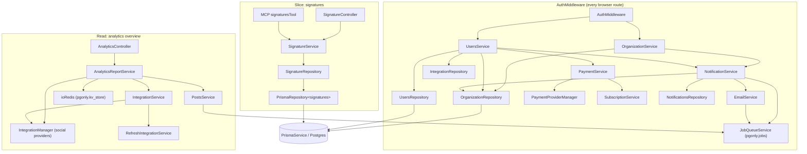

# Nest coupling and risk map (Phase 0, P0-B and P0-D)

**Measured:** 2026-11-03 on source identical to `main` `f6bea7fe`. Wire results come from the local production build against a disposable Postgres (commands in [openapi-coverage.md](openapi-coverage.md#how-to-reproduce)); everything else is cited to source.

## Flow traces

### Read: the analytics page (`/analytics` → `GET /analytics/overview?date=7`)

The handoff named `apps/frontend/src/components/analytics/analytics.component.tsx` as the example read. It is **dead code**: nothing imports `AnalyticsComponent`, and the two keys it fetches, `GET /analytics` and `GET /analytics/trending`, have no route in the backend (upstream GitHub-stars leftovers). The page the router actually serves is traced instead.

1. **Route.** `apps/frontend/src/router.tsx` maps `analytics` → `app/(app)/(site)/analytics/page.tsx` → `PlatformAnalytics` (`components/platform-analytics/platform.analytics.tsx`) → `OverviewAnalytics` (`overview.analytics.tsx`).
2. **SWR hook.** `useOverviewAnalytics(date)` calls `useSWR<OverviewData>('/analytics-overview-${date}', load)` with every revalidation off except on mount; `load` is `fetch('/analytics/overview?date=${date}')` from `useFetch()`. `OverviewData` is a handwritten interface in the same file.
3. **customFetch** (`libraries/helpers/src/utils/custom.fetch.func.ts`). URL = `backendUrl + path`, where `backendUrl` is `useVariables().backendUrl` from `window.__RUNTIME_CONFIG__`, written from `NEXT_PUBLIC_BACKEND_URL` (`apps/frontend/runtime-config.mjs`; production `https://host/api`). Sends `credentials: 'include'` (the `auth` cookie travels), `Content-Type: application/json`, `Accept: application/json`, `cache: 'no-store'`, and `auth`/`showorg`/`impersonate` headers only when the cookie is readable from `document.cookie` (non-secured mode) or `?loggedAuth=` is in the URL.
4. **After the response** (`components/layout/layout.context.tsx`, `afterRequest`): stores `auth`/`showorg`/`impersonate` response headers as cookies, follows `reload`/`onboarding`, and on `401` or a `logout` header sends the browser to `/`. On `406` (trial) and on `402` when the user accepts the dialog it returns `false`, and `customFetch` then returns a promise that never settles — deliberate: the page is being left or the dialog took over, so SWR stays in loading instead of rendering an error. Nothing to fix here; any replacement client must reproduce it.
5. **nginx** strips `/api/` → `GET /analytics/overview?date=7` on `:3000`.
6. **Nest pipeline.** `AuthMiddleware` (cookie or header JWT → user re-read from the database → organization chosen by `showorg` among the user's own) → global `ThrottlerBehindProxyGuard` (does not count this route) → global `PoliciesGuard` (no policy on this handler) → `ValidationPipe({ transform: true })` turns `?date=7` into the number `7` through `AnalyticsOverviewDto`'s `@Type(() => Number) @IsIn([7, 30, 90])`.
7. **Controller → service → data.** `AnalyticsController.overview` → `AnalyticsReportService.overview(org.id, days)` → cache lookup in `pgonly.kv_store` (`ioRedis`, the Postgres replacement for Redis) → `build()` → `IntegrationService.getIntegrationsList(orgId)` → for each channel, in batches, `IntegrationService.checkAnalytics`, which may **refresh the channel's token, call the social platform, and disconnect the channel** if the refresh fails → the report is written back to the cache for an hour (one second in development).
8. **Wire (measured, organization with no channels):** `200 application/json` `{"event":"analytics.report","generatedAt":"…Z","period":{"days":7,"from":"…Z","to":"…Z","previousFrom":"…Z","previousTo":"…Z"},"summary":{"channels":0,"metrics":{}},"channels":[],"topPosts":[]}`. Without `date`: `400 {"message":["date must be one of the following values: 7, 30, 90"],"error":"Bad Request","statusCode":400}`. OpenAPI declares neither the `date` query parameter nor the response.
9. **Mismatches.** The SPA's `OverviewData.period` is `{ days }` while the wire also carries `from`, `to`, `previousFrom`, `previousTo`, `event`, `generatedAt` (all dates as strings). The type is a hand-picked subset, not a contract. Not low risk: with channels connected this "read" calls external APIs and can write (token refresh, disconnect, cache).

Neighbouring read, for contrast: `GET /analytics/:integration` with an unknown id answers `500 {"statusCode":500,"message":"Internal server error"}` because `checkAnalytics` throws a plain `Error('Invalid integration')` — measured locally.

### Write: add a signature (Settings → Signatures → Add)

1. **Component.** `components/settings/signatures.component.tsx`: the list is `useSWR('signatures', load)` with `load = fetch('/signatures').json()` — untyped (`data` is `any`). The form validates with a yup schema `{ content: string().required(), autoAdd: boolean().required() }` and submits `fetch(id ? '/signatures/${id}' : '/signatures', { method: id ? 'PUT' : 'POST', body: JSON.stringify(values) })`. It does not read the response or check its status: it shows "Signature added successfully" and calls `mutate()` regardless.
2. **customFetch, nginx, `AuthMiddleware`, guards** — as in the read.
3. **Validation.** `SignatureDto` (`libraries/nestjs-libraries/src/dtos/signature/signature.dto.ts`): `content` `@IsString @IsDefined`, `autoAdd` `@IsBoolean @IsDefined`. Measured bad body `{"content":123}` → `400 {"message":["content must be a string","autoAdd should not be null or undefined","autoAdd must be a boolean value"],"error":"Bad Request","statusCode":400}`. A body over 100 kB → `413 {"statusCode":413,"message":"request entity too large"}`.
4. **Controller → service → repository.** `SignatureController.createSignature(org, body)` → `SignatureService.createOrUpdateSignature(org.id, body)` (for `PUT`, first checks the id belongs to the organization and throws `NotFoundException` otherwise) → `SignatureRepository.createOrUpdateSignature` → Prisma `signatures.upsert({ where: { id: id || uuidv4(), organizationId } })`, and when `autoAdd` is true, `updateMany` turns `autoAdd` off on the organization's other signatures.
5. **Wire (measured).** `201 {"id":"<uuid>"}`. The list then returns `[{"id","organizationId","content","autoAdd","createdAt":"2026-11-03T09:41:16.818Z","updatedAt":"…","deletedAt":null}]` — raw Prisma rows, `Date` as ISO strings.
6. **Organization boundary (measured).** A second user's list does not contain it; sending the second organization's id as `showorg` silently falls back to the caller's own organization. No 403.
7. **Copies of this one shape today:** Prisma model, `SignatureDto` (HTTP input), zod `signatureSchema` and `toSignature()` in `chat/tools/signatures.tool.ts` (MCP output, dates converted with `toISOString()`), yup `details` (form), untyped SWR data (SPA).

Steps 3, 5 and 6 and the 401 path are pinned by `apps/backend/src/main.spec.ts`.

## What Nest provides on every request

| Concern | Where | Notes for any non-Nest route |
| --- | --- | --- |
| Raw body, CORS, cookies, compression, 50 MB JSON for `/posts` and `/copilot/*` | `apps/backend/src/main.ts` | Express-level; a sub-app mounted on the same Express instance inherits them only if mounted after them |
| Global `ValidationPipe({ transform: true })` | `main.ts` | class-transformer coercion (`@Type(() => Number)`), the 400 message-array shape |
| Filters: `SubscriptionExceptionFilter`, `PostValidationExceptionFilter`, `HttpExceptionFilter` | `main.ts` | the last turns `HttpForbiddenException` into `401` + cleared cookie + `logout: true` |
| Global guards: `ThrottlerBehindProxyGuard` (Postgres storage), `PoliciesGuard` (CASL abilities via `PermissionsService`) | `app.module.ts` `APP_GUARD` | policies read `org.users[0].role` set by the middleware |
| Auth middleware per controller | `api.module.ts`, `public.api.module.ts` `configure()` | bound to controller classes, not paths |
| Param decorators `@GetOrgFromRequest`, `@GetUserFromRequest` | `libraries/nestjs-libraries/src/user/*.from.request.ts` | read `req.org` / `req.user` |
| Sentry user context | `AuthMiddleware` → `setSentryUserContext` | |

## Dependency paths for the two slices

- **Signatures** needs four classes below the controller and one `@nestjs/common` symbol in its service (`NotFoundException`, plus `@Injectable`). It is used by the MCP `signaturesTool` (same service methods, listed in `mirrors`), not by the public API, not by the orchestrator's jobs or activities. It is still constructed in the orchestrator process, because `DatabaseModule` is one `@Global` module of 57 providers (`database.module.ts`) that the backend and the orchestrator both import.
- **Analytics overview** pulls in the provider layer (`IntegrationManager` with every social provider, token refresh) and the Postgres cache; the orchestrator runs the same `IntegrationService` for publishing and analytics webhooks.
- **Auth** is the heavy part: authenticating one browser request constructs, through DI, services that reach billing (`PaymentService` → `SubscriptionService`) and the job queue (`NotificationService`/`EmailService` → `JobQueueService`). A route outside Nest would either call into Nest's container (`app.get(UsersService)`, as `startMcp` already does for MCP) or re-implement `AuthMiddleware`, its 401 filter, the `showorg` fallback and `impersonate` — exactly the behavior `main.spec.ts` pins.

**Would a Hono endpoint simplify the signatures slice?** The controller is a 55-line file of decorators and delegation (`signature.controller.ts`). A Hono version would replace those lines but still need: Nest's container for `SignatureService` (or a second way to construct it and its Prisma repository), the auth bridge above, the validation and error shapes, mounting at the internal path behind nginx, and a parity-manifest change so `mirrors` still covers it. Net: more moving parts for the same five routes. The typed-contract gain does not depend on Hono — see the ADR.

## Process and worker separation

- **Backend** (`apps/backend`, port 3000): HTTP, MCP (mounted by `startMcp` with `app.use` before the pipes and filters, reading services with `app.get(..., { strict: false })`), Swagger, the throttler, and producers of jobs through `JobQueueService` (notifications, emails, post scheduling via `PostsService`).
- **Orchestrator** (`apps/orchestrator`, its own Nest app, health check on `ORCHESTRATOR_PORT` 3002): imports `DatabaseModule`, `VideoModule`, `JobsModule`; runs `JobWorkerService` with the job handlers in `jobs/` and the services they call in `activities/`. It shares every service class with the backend through `DatabaseModule`, but no HTTP pipeline.
- **`pgonly.jobs`** (`libraries/nestjs-libraries/src/jobs/job.queue.ts`): Postgres is the queue (`FOR UPDATE SKIP LOCKED`), the wake-up (`LISTEN/NOTIFY`) and the clock (`run_at`); running jobs hold a lease (`locked_until`), `attempts`/`max_attempts` (default 3) drive retries, and a partial unique index on `dedupe_key` for pending/running rows deduplicates. Per-post work is serialised by a transaction-scoped advisory lock (`pg_advisory_xact_lock(hashtext('post:<id>'))`), and a job of a mid-publish kind is never cancelled or replaced, because that would publish twice. `JobQueueService` works with or without Nest DI (`new JobQueueService()`).
- Root `vite.config.ts` `test.include` omits `apps/orchestrator/**/*.spec.ts`; there are currently **0** such files, so nothing is skipped today, but a future orchestrator spec would be silently ignored.

## No-touch / high-risk regions

| Region | Why |
| --- | --- |
| `/public/v1/*` (35 routes) | Versioned external contract: CLI (`apps/cli`), SDK (`apps/sdk`), Canva app, API-key holders. Error bodies are `{ msg }`, not Nest's shape |
| MCP transports and OAuth discovery (`start.mcp.ts`, `/oauth/*`) | Streamable HTTP, SSE, four OAuth resource paths with different toolsets, RFC 8414/9728 metadata whose URLs drop `/api` (see the inventory), DCR clients that cache metadata |
| Provider webhooks `POST /stripe`, `POST /payment/:provider`, `POST /public/modify-subscription` | Signature checked over `req.rawBody`; billing code must never throw (`CLAUDE.md`) |
| `POST /posts`, `POST /public/v1/posts` | 50 MB JSON, `any` body validated in the service, enqueues publish jobs |
| Uploads (`/media/upload-*`, `/media/:endpoint`, `/media-widget/upload`, `/public/v1/upload`) | multipart streaming to storage, chunked protocol |
| `POST /copilot/chat`, `POST /copilot/agent` | CopilotKit runtime stream through `@Res` |
| `GET /public/stream` | media proxy with URL allow-listing |
| Anything that enqueues or handles `pgonly.jobs` | lease, retry, dedupe, drain on shutdown; a mistake publishes twice |
| Auth-flow routes that set cookies with `@Res` | cookie domain/flags differ between secured and `NOT_SECURED` modes |

## Candidate slices

| Candidate | Why it is low risk | What it still touches |
| --- | --- | --- |
| **1. Signatures** (5 routes) — recommended | DB-only, organization-scoped, one service + one repository, no jobs, no providers, not public API, characterized over HTTP | `AuthMiddleware` and its DI; the MCP tool's zod copy of the response |
| **2. Analytics overview read** — not recommended as a first slice | It is the most visible read, and its query DTO shows the coercion a new contract must keep | Social-platform calls, token refresh/disconnect, cache writes |

For a second low-risk slice, `sets` (`SetsService` → `SetsRepository`, MCP `setsTool`) has the same shape as signatures; it was not exercised over HTTP in Phase 0.
