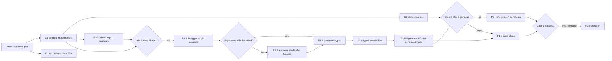

# Plan: typed API contract, Hono, and the Phase 0 findings

- **Status:** Proposed, not started. Every phase below still needs the owner's explicit approval; this document is not that approval.
- **Date:** 2026-11-03
- **Inputs:** [ADR 0001](../adr/0001-typed-api-contract-migration.md), [api-route-inventory.md](api-route-inventory.md), [openapi-coverage.md](openapi-coverage.md), [nest-coupling-map.md](nest-coupling-map.md), `apps/backend/src/main.spec.ts`.

"Do it all" covers five workstreams. Two of them (guardrails and the Phase 0 fixes) are useful whatever is decided about Hono, so they go first; Phase 2 and Phase 3 only run if a measured gate says they pay off.

| Workstream | What | Depends on | Gate before it starts |
| --- | --- | --- | --- |
| **G. Guardrails** | Contract snapshot test, framework-neutral route manifest, frontend import boundary | nothing | owner approves this plan |
| **F. Phase 0 fixes** | The defects and risks Phase 0 recorded | nothing; independent small PRs | owner picks which (some are product decisions) |
| **P1. Typed contract (Phase 1)** | Swagger plugin → measured OpenAPI → generated types → typed SPA hooks, slice by slice | G1, G3 | **Gate 1**: approval to start Phase 1 |
| **P2. Hono pilot (Phase 2)** | One slice served by Hono behind a measured go/no-go | P1 done for that slice, G2 | **Gate 2**: go/no-go report accepted |
| **P3. Expansion (Phase 3)** | More slices on whichever approach won | P1 or P2 proven | **Gate 3**: per-batch approval |

## Rules for every step

- One step, one branch, one PR, opened as a draft from a fresh worktree. **Merging to `main` deploys to production** (`.github/workflows/deploy.yml`), so only the owner merges, after reading the QA section.
- PR description follows `.github/PULL_REQUEST_TEMPLATE.md` with numbered `# QA` steps.
- Gates that must stay green on every PR: `pnpm check`, `pnpm build`, `TEST_DATABASE_URL=… pnpm test` (includes `main.spec.ts` and `mcp.parity.spec.ts`). `main.spec.ts` must pass **unchanged** through every migration step; a step that needs to change it is changing wire behavior and must say so in its PR title.
- Tests follow the repository rule: public seams (HTTP, exported entry points), real Postgres, no mocks, no sleeps. Each new test names the promise it protects.
- No change to Prisma models, `pgonly.*` tables or job semantics, the orchestrator, MCP transports, provider webhooks, `/public/v1` responses or uploads unless the step says so explicitly.
- Anything live (production env, Dokploy, DNS, Traefik) is done by the owner or with the owner's go-ahead, and recorded in `omninoise-ops` (`docs/status.md`, `docs/log.md`).
- Rollback for every code step is "revert the PR"; steps where that is not enough say what else is needed.

## G. Guardrails (before Phase 1)

### G1. OpenAPI contract snapshot test

- **Why:** today nobody would notice if the OpenAPI document changed. Phase 1 changes it on purpose; the change must show up in review as a diff.
- **Change:** commit the served document as `apps/backend/openapi.json` (generated from a booted backend, like Phase 0's evidence file) and add a spec that boots `main.ts` the way `main.spec.ts` does, fetches `/docs-json`, and fails with a diff when it differs from the committed file. A `pnpm api:snapshot` script rewrites the file.
- **Test:** the spec is the test. Proof it bites: add a throwaway `@ApiTags` locally, the spec fails, remove it.
- **Risk:** none at runtime (test and a committed JSON only).

### G2. Framework-neutral route manifest for the MCP parity rule

- **Why:** `mcp.parity.spec.ts` finds routes by regex over Nest decorators. A route defined any other way (Hono, `app.use`) would silently escape the "every web route has an MCP tool or an EXCLUDED reason" rule ([inventory §6](api-route-inventory.md#6-mcp-parity-parser-vs-a-framework-neutral-manifest)).
- **Change:** the parity spec reads the routes from the booted app instead of source text: Nest's routes (equal to the OpenAPI operations, 245/245 measured) plus any router registered on the HTTP adapter, each tagged with an owner (`nest`, `express-mcp`, later `hono`). New checks: a `METHOD path` with two owners fails; a path under `/api` fails. Keep `EXCLUDED` and `mirrors` exactly as they are.
- **Test:** the existing parity tests keep passing with the new source of routes; one new test asserts the manifest equals the regex parser's set today (245) so the switch provably loses nothing, then the regex parser is deleted.
- **Risk:** test-only. Needed before Phase 2 at the latest, useful now.

### G3. Frontend import boundary (a ratchet, not a ban)

- **What exists today (measured while writing this plan):** 57 files in `apps/frontend/src` and `libraries/react-shared-libraries/src` already import server code at runtime:
  - 35 import request DTO classes from `@gitroom/nestjs-libraries/dtos/*`, and 12 of those validate forms with them through `classValidatorResolver`. The SPA already shares the **request** contract with the backend, class-validator rules included.
  - 10 import from `@prisma/client` (model types and enums such as `State`).
  - The rest import small shared modules: `services/make.is` (`makeId`), `user/track.enum`, `database/prisma/subscriptions/pricing`, `integrations/social/analytics.metrics`.
- **Why:** the typed contract must not add more server code to the browser bundle (ADR 0001, "types only across the boundary"), but the existing imports work and are not Phase 1's problem.
- **Change:** an architecture spec that lists every runtime import from `@gitroom/nestjs-libraries/*`, `@prisma/client`, `@nestjs/*` or `@gitroom/backend/*` in the frontend and compares it with a committed allow-list of today's 57 files. A new file fails; removing one shrinks the list. `import type` and the generated folder of P1.3 are always allowed.
- **Test:** the spec is the test; it passes on today's tree by construction, and fails when a throwaway import is added.
- **Consequence for P1:** request types should come from the same DTO classes the forms already use (through the plugin metadata), so the form schema and the API schema cannot drift. Response types are the gap P1 fills.

## F. Fixes for the Phase 0 findings

Independent small PRs; they can run in parallel with G and P1. Items marked **decision** need the owner to choose the behavior first.

| # | Finding (evidence) | Proposed change | Test | Notes |
| --- | --- | --- | --- | --- |
| F1 | MCP OAuth discovery URLs drop `/api` with the production base URL (inventory §4) | **Step 1, read-only, owner go-ahead:** `curl -sI` the production `…/.well-known/oauth-protected-resource/mcp-oauth-dynamic` with and without `/api` to see which one answers. **Step 2:** if the `/api`-less URLs are not served, build the advertised URLs from the base path (`new URL('mcp-oauth-dynamic', base + '/')`) in `start.mcp.ts`, and keep answering the old paths for clients that cached them | spec booting `main.ts` with `NEXT_PUBLIC_BACKEND_URL=https://host/api`, asserting `WWW-Authenticate` and the metadata URLs keep `/api` | High care: Claude/ChatGPT/Cursor cache metadata. Check `omninoise-ops` MCP runbook before and after |
| F2 | `POST /oauth/register` unthrottled; `DCR_VERIFIED_DOMAINS` unset (inventory §8.3) | Add `@UseGuards(ThrottlerRealIpGuard) @Throttle(...)` as on `/oauth/authorize/self-hosted`. **Decision:** set `DCR_VERIFIED_DOMAINS` in production (owner, ops repo compose) or keep open | spec: N+1th registration from one IP answers 429 | Pick a limit that a legitimate MCP client never hits (re-registers on reconnect) |
| F3 | `GET /analytics/:integration` unknown id → 500 (plain `Error`) | Throw `NotFoundException('Invalid integration')` in `IntegrationService.checkAnalytics` | spec over HTTP: 404 with Nest's body | Same method backs `GET /public/v1/analytics/:integration` and the MCP `analyticsTool`: public API changes 500 → 404 too; say so in the PR and the SDK/CLI notes |
| F4 | `AuthMiddleware` answers any error, a DB outage included, with 401 + logout (inventory §4) | **Decision.** Option: keep 401 only for token/user problems, let infrastructure errors become 500 so users are not logged out by a database blip | spec: invalid JWT still 401 + logout (already pinned); a DB failure is hard to provoke without mocks, so assert via a closed Prisma pool in a dedicated spec, or document as untested | Security-sensitive: must never turn an auth failure into a pass |
| F5 | `showorg` for a foreign org silently falls back (inventory §4) | **Decision.** Keep (document as intended) or answer 403 | already pinned by `main.spec.ts`; a change edits that test on purpose | Changing it affects the SPA's org switcher after a user leaves an org |
| F6 | Dead SPA code calling missing routes: `analytics.component.tsx`, `stars.*`, `comments/comment.component.tsx`, GitHub onboarding; reachable `POST /billing/lifetime` (inventory §5) | Delete the unreferenced components; **decision** for `billing/lifetime`: remove the route from `router.tsx` (billing is off in this fork) or keep | `pnpm build` + the inventory script shows 0 SPA calls to missing routes | Pure deletion; check i18n keys are not orphaned noisily |
| F7 | `GET /monitor/queue/:name` always "healthy" | **Decision:** make it read `pgonly.jobs` (oldest due pending job age) through `JobQueueService`, or delete it | spec: a stale due job makes it unhealthy | Check no external uptime monitor depends on it first (ops repo) |
| F8 | Root `vite.config.ts` test include omits `apps/orchestrator/**/*.spec.ts` (0 files today) | Add the pattern | none needed beyond `pnpm test` still passing | One line |
| F9 | `tsc -p apps/backend/tsconfig.json` has 20 errors in existing files; not a CI gate | Fix the 20, then add a `typecheck` script and run it in the existing CI job | the new CI step | Separate PRs: fixes first, gate second |
| F10 | `/oauth/token` mixes RFC `{error}` bodies with Nest's validation list | **Decision:** map validation failures on `/oauth/*` to RFC 6749 `invalid_request` | spec on `/oauth/token` with a missing `code` | OAuth clients parse the RFC shape |
| F11 | Body-parser 413s are reported to Sentry as errors | Optional: treat `entity.too.large` as expected | — | Noise only |

## P1. Typed contract on Nest (Phase 1)

Starts after **Gate 1** (owner approval) and G1, G3.

### P1.1 Swagger plugin metadata

- **Change:** generate the plugin's metadata with `PluginMetadataGenerator` (`@nestjs/cli` 11.0.21) and `ReadonlyVisitor` (`@nestjs/swagger` 11.4.7) into a committed `apps/backend/src/metadata.ts`, and load it in `loadSwagger` with `SwaggerModule.loadPluginMetadata()` before `createDocument`. Chosen over adding the plugin to `nest-cli.json` because the generated file also works when `main.ts` is booted by Vitest (oxc transform, no Nest compiler), which is how G1 and `main.spec.ts` run. A `pnpm api:metadata` script regenerates it; a spec fails when the committed file is stale.
- **Measure:** re-run `docs/architecture/evidence/api-inventory.mjs`; record request/response coverage in the PR. The G1 snapshot diff shows exactly what the document now publishes.
- **Decision before merge:** `/api/docs-json` is public. Filling it in publishes the request/response shapes of browser routes too. Options: accept; or keep `/docs` for `/public/v1` only (`include` option of `createDocument`) and generate the browser contract at build time without serving it.
- **Runtime effect:** none on request handling (metadata only affects the Swagger document). Verified by `main.spec.ts` unchanged.

### P1.2 Response models for the signatures slice (only if P1.1 leaves responses undescribed)

- **Change:** `@ApiOkResponse({ type: SignatureResponse })` etc. with a response class next to `SignatureDto`, matching the measured wire shape (dates as `string` `date-time`, `deletedAt` nullable). Record the duplication cost (Prisma model + response class + MCP zod) in the PR; that number feeds Gate 2.
- **Test:** G1 snapshot shows the schema; `main.spec.ts`'s signature test already pins the wire shape the schema must match.

### P1.3 Generated types (types only)

- **Change:** add `openapi-typescript` (dev dependency, types only, no runtime client) and generate `libraries/helpers/src/api/openapi.d.ts` from `apps/backend/openapi.json` with `pnpm api:types`. A spec regenerates into a temp file and fails if the committed `.d.ts` is stale.
- **Why not Orval now:** a runtime client would replace `customFetch`, whose `afterRequest` behavior (cookie updates, 401 → `/`, the deliberate never-settling promise on 402/406) the SPA depends on (nest-coupling-map, read trace step 4).

### P1.4 Typed fetch helper over `useFetch`

- **Change:** a small generic helper in `libraries/helpers/src/utils/` that takes a `paths` key and method from the generated types, calls the existing `useFetch()` function, and returns the typed JSON. Keeps every `customFetch` behavior. Evaluate `openapi-fetch` with `fetch: customFetch` first; prefer it if it keeps the never-settling branch, otherwise write the ~30-line helper.
- **Test:** a frontend spec (jsdom, existing pattern `apps/frontend/**/*.spec.ts`) against a tiny local HTTP server: 200 typed body, 401 path goes through `afterRequest`.

### P1.5 Signatures SPA on generated types

- **Change:** `signatures.component.tsx`: the form switches from its yup schema to `classValidatorResolver(SignatureDto)`, as 12 forms already do, so form and API validate the same rules; the list hook becomes a separate `useSignatures()` SWR hook (CLAUDE.md hook rule) typed from the generated `paths`; the save call uses the typed helper and checks the response status before showing "success" (today it toasts success even on 400 — a behavior fix, called out in the PR). 
- **Test:** `pnpm build` type-checks the component; QA steps exercise add/edit/delete in the browser against a local backend.

### P1.6 More slices

- **Order:** by low risk and high SPA use, re-measured each time: `sets`, `posts/tags`, `webhooks` (without `send`), `notifications`, then reads with external calls last. `/public/v1/*` gets its own track: publishing its schema helps the CLI and SDK, but its error body (`{ msg }`) differs and must be described, not changed.
- **Each slice:** coverage measured before/after, G1 diff reviewed, `main.spec.ts`-style characterization added for the slice's wire contract if it has none.
- **Follow-up (decision):** MCP tools hand-write zod output schemas for 70 tools; once a slice's response schema exists, the matching tool could reuse it. Separate decision, because MCP output shapes are a contract with agents.

## P2. Hono pilot (Phase 2) — only after Gate 2

**Gate 2, go/no-go report** (written after P1.5, numbers not opinions):

1. Lines and files a Hono version of `signatures` would remove vs add (controller 55 lines today).
2. Whether auth can be reused without duplicating it: a measured prototype calling Nest's container (`app.get(AuthMiddleware)` or the services it needs), as `startMcp` already does.
3. Type-check cost of `hc<AppType>` in the SPA with a pre-built declaration file (time of `pnpm build` before/after).
4. `main.spec.ts` passing unchanged against the Hono-owned routes in the spike.
5. What P1 already delivered: if the SPA is typed through generated types, Hono's main benefit is gone and the answer is likely no-go.

If **go**, on `signatures` only:

- **P2.1** Add `hono` and `@hono/node-server`; mount the Hono app on the existing Express instance in `main.ts` at the internal paths (never `/api`), after cookies/CORS/body parsers and with the same auth middleware bridged from Nest's container; register it in the G2 manifest with owner `hono`.
- **P2.2** In the same PR remove the five Nest `signatures` routes (one owner per route; G2 fails otherwise). `SignatureService`, `SignatureRepository`, the MCP `signaturesTool` and `mirrors` keep working unchanged.
- **P2.3** Error mapping: Hono validation failures must produce the same 400 body as `ValidationPipe`, auth failures the same 401 + logout + cookie; pinned by `main.spec.ts` unchanged.
- **Rollback:** revert the PR; the Nest controller comes back with it. No data or schema change.

If **no-go**, record the decision in a new ADR and continue P1.6.

## P3. Expansion (Phase 3) — only after Gate 3

- Batches of slices on the approach that won, each batch approved separately, each with the per-slice checklist from P1.6.
- Never in Phase 3 without its own ADR: `/public/v1`, MCP transports and OAuth discovery, provider webhooks, uploads, `/posts` (50 MB, job enqueue), CopilotKit streams, anything touching `pgonly.jobs`. Removing Nest from the backend or the orchestrator stays rejected (gap review tradeoff matrix).

## Rough size

| Step | PRs | Size |
| --- | --- | --- |
| G1–G3 | 3 | small, tests only |
| F1–F11 | up to 11 | each small; F1, F4, F9 medium |
| P1.1–P1.5 | 4–5 | small to medium |
| P1.6 | 1 per slice | small |
| Gate 2 report + P2 | 1 spike (not merged) + 1 | medium |
| P3 | per batch | depends on Gate 3 |

## What the owner needs to decide now

1. Approve this plan as the order of work (G first, F in parallel, P1 behind Gate 1).
2. Which F items to do, and the behavior for the **decision** items: F2 (`DCR_VERIFIED_DOMAINS`), F4 (logout on DB errors), F5 (`showorg`), F6 (`billing/lifetime`), F7 (queue monitor), F10 (OAuth error shape).
3. Gate 1: whether Phase 1 may start after G1 and G3, and the P1.1 decision on what `/api/docs-json` publishes.
4. The read-only production check for F1.

Phase 2 and Phase 3 need separate approvals later; nothing here starts them.
