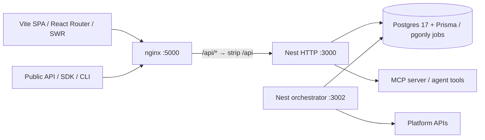

# Kanna Handoff — Omninoise API Contract Audit / Phase 0

**Status:** APPROVED FOR PHASE 0 ONLY (user confirmed 2026-11-03).
**Repo:** https://github.com/cuongtranba/omninoise
**Documentation branch:** `docs/phase-0-typed-api-handoff-20261103` (do not merge or push to `main`; production deployment runs on main pushes).
**Companion evidence:** `docs/architecture/omninoise-architecture-gap-review.md`
**Kanna project:** `omninoise`
**Strategic direction, not this task:** Vite SPA + SWR + a single typed API contract, with potential incremental Hono RPC migration after explicit approvals.

## Authorization boundary — STRICT

**Do Phase 0 only.** You may inspect repo and create focused architecture/contract documentation, ADR and deterministic HTTP characterization tests on a new worktree/branch. You may use a disposable local Postgres and launch an isolated local Nest app to extract actual OpenAPI.

**Do not:** install or introduce Hono, migrate any HTTP route, add Orval or a typed frontend client, rewrite DTOs into Zod, refactor business services, modify Prisma schema or `pgonly` job tables, modify deployment configuration, deploy, merge PRs, touch production databases/accounts, rewrite orchestrator or MCP transport, or start Phase 1/2/3. A recommendation in an ADR is not permission to implement it. **Stop after Phase 0 and request new user approval.**

## Mandatory knowledge/safety setup

1. Read `CLAUDE.md`, `README.md`, `pnpm-workspace.yaml`, root `vite.config.ts`, `.github/PULL_REQUEST_TEMPLATE.md`, existing docs/wiki/ADRs and relevant tests. Respect established naming and no-shortcut conventions.
2. Inspect local branch, existing worktrees, uncommitted changes, remotes, ahead/behind and current GitHub main HEAD. Do not overwrite or reset user work. Never force-push. Use a **new git worktree** and a focused branch; reuse the documentation branch as the base after safely fetching it. If there is divergence, ask rather than silently rebasing or dropping work.
3. This handoff was created by a **read-only GitHub source review**, not by running the application. Independently verify every fact; label incomplete and blocked results rather than inventing endpoint counts or test passes.
4. Avoid secrets, real social-media publishing, billing callbacks, live data modifications and production DB addresses. Use disposable test database and stubs only where permitted by existing test policies; prefer real public-seam tests over mocks.
5. Keep architecture shallow, related logic together, existing styles and domain names, no `@ts-ignore` / `@ts-expect-error` / `as any` escapes, no artificial sleeps, no speculative refactoring. Follow test-first development for any test infrastructure added. Use only pnpm.
6. Respect the repo's `CLAUDE.md` route/MCP parity invariant, credential-exposure rules, immutable workflow versions, provider abstraction rules and `# QA` PR structure.

## Baseline to protect

Read at minimum:
- `apps/backend/src/main.ts`, `app.module.ts`, `api/api.module.ts`, `api/routes/`, `public-api/`
- `apps/backend/src/services/auth/auth.middleware.ts`, `services/auth/permissions/permissions.guard.ts`
- `apps/orchestrator/src/main.ts`, `app.module.ts`, `jobs/`
- `libraries/nestjs-libraries/src/database/prisma/`, `jobs/job.queue.ts`, `chat/start.mcp.ts`, `chat/mcp.parity.spec.ts`
- `libraries/helpers/src/utils/custom.fetch.func.ts`, `custom.fetch.tsx`, `swagger/load.swagger.ts`
- `apps/frontend/src/components/analytics/analytics.component.tsx`, `src/router.tsx`, `vite.config.ts`, `runtime-config.mjs`
- `apps/sdk/`, `apps/cli/`, `var/docker/nginx.conf`, `var/docker/entrypoint.sh`, `var/docker/ecosystem.config.js`, `Dockerfile`, CI workflows.

## Phase 0 work packages (authorized)

### P0-A. Repository and route inventory

Produce `docs/architecture/api-route-inventory.md` (or existing canonical docs location if different).

- Record HEAD commit, branch/worktree, whether source differs from this handoff.
- Enumerate **effective** method + public URL + Nest internal path; do not confuse nginx public `/api/posts` with internal `/posts`.
- Group browser/private REST, versioned `/public/v1`, OAuth, webhooks, SSE, media/multipart, large JSON, MCP-mounted endpoints, monitoring/health and external consumers.
- Identify auth strategy, exposed headers/cookies, request/response content types and consumers where verified; explicitly mark unknown.
- Compare Nest decorator route collection with `mcp.parity.spec.ts`; document a **framework-neutral route manifest design**, do not replace parser in this phase unless needed for narrowly scoped characterization.

### P0-B. Trace two representative flows

In the same inventory or a linked flow document:
- One SPA **read** (e.g. `/analytics` read) and one SPA **write** (choose safe existing behavior). Trace component/SWR/customFetch → runtime backend URL → nginx → controller → service/repository → response.
- Record which auth headers/cookies travel across, 401/403/validation/error shape, organization boundaries, serialization and any mismatch between compile-time DTO and wire JSON.
- Never send a real post, trigger billing, publish to social platforms, or mutate a production account just to exercise the flow.

### P0-C. Measured OpenAPI audit

Produce `docs/architecture/openapi-coverage.md` with **reproducible** local command(s) and results.

- From disposable local environment, extract current Nest OpenAPI document (Swagger `/docs`; inspect actual JSON route). Do not assume docs existence equals schema completeness.
- Count operations by method and surface. For each: successful and error status response schemas, request body/schema, path/query parameters, file/stream/non-JSON endpoints, unspecified/opaque bodies.
- Include a coverage numerator/denominator with definition and concrete examples of weak schemas; call out why plain generated TS types might mislead.
- Assess feasibility of server-owned OpenAPI → typed client (e.g. Orval) without duplicating handwritten frontend response models. Do **not** install generator yet or modify frontend.
- If local server cannot start, document commands attempted, error and evidence; static inspection is secondary and must not masquerade as measured runtime coverage.

### P0-D. Dependency/coupling and risk map

Produce `docs/architecture/nest-coupling-map.md`.

- Trace `@Injectable`/`@Module`/`@nestjs/common` dependencies for 1–2 **potential** low-risk read/write vertical slices.
- Map Nest request context, DI construction, class validation/transformation, Prisma, org policies, auth cookie context, global filters, per-route handlers and MCP tool mirrors.
- Distinguish Nest HTTP coupling from Nest orchestrator/shared services. Identify why a theoretical Hono endpoint might still need Nest DI and whether it would provide net complexity improvement.
- Flag external versioned API/SDK, MCP OAuth/stream, webhook raw-body signatures, SSE, uploads, 50MB JSON and `pgonly` worker retry/lease/dedup as no-touch/high-risk regions.

### P0-E. Characterization tests at public seams

Add a **small, meaningful, deterministic** baseline test suite for existing observable behavior where currently missing, following repository Vitest style and public API seams.

- Prioritize internal/public URL rewrite semantics and representative auth/authorization/organization boundaries or validation/error response behavior that can be tested safely in a disposable local runtime.
- Include relevant existing MCP route parity tests in the test run. Where a critical surface is not practical to exercise locally (external provider upload, OAuth callback, stream), document how it should be tested before future migration rather than simulating success.
- No private-function assertions, sleeps, handwavy mocks, test-only shortcuts, secrets or production side effects. Test must fail meaningfully if behavior changes. Test exact method/status/body/headers as appropriate.
- Do not rewrite production endpoints to facilitate tests; if this cannot be done safely, record a blocker and propose a bounded fixture/harness change for approval.

### P0-F. ADR + sign-off gate

Write a short ADR following any existing docs convention (suggested `docs/adr/NNNN-typed-api-contract-migration.md`).
- Compare (a) Nest Swagger/OpenAPI + generated typed client, (b) shared Zod contract with Nest adapter, (c) isolated Hono RPC; articulate codegen, ergonomics, correctness, runtime validation, type checking, external API and migration cost.
- Select **one or two recommended future slices** grounded in actual measured dependencies. No route implementation.
- Include rollout/rollback, how to ensure one route owner, what must happen to the MCP parity parser, and safeguards to avoid browser bundling of Node/Prisma code.
- State the next explicit user approval needed before Phase 1.

## Acceptance/QA evidence

| Deliverable | What counts as done |
| --- | --- |
| Route inventory | Reproducible enumeration and grouping, effective paths and consumer/auth matrix, unknowns listed |
| OpenAPI report | Actual schema counts, denominator, extraction command, missing metadata examples, blockers |
| Flow traces | One read and one write traced to observable HTTP wire behavior, no production side effects |
| Coupling map | DI/framework dependency path for plausible slices and worker/MCP separation |
| Characterization | Narrow meaningful tests added and run, with exact commands/results or honest blockers |
| ADR | Decision with alternatives, measured evidence and explicit future approval gate |
| PR | PR template complete, exact `# QA` numbered steps, no production route migrations |

Do not claim runtime, memory, performance or reliability improvements from this audit; nothing has been deployed.

## Compatibility checklist for future migration (risk inventory ONLY in Phase 0)

- nginx `/api/` prefix stripping, Vite runtime `backendUrl`, SPA `useFetch` and SWR cache semantics.
- `auth`, `showorg`, `impersonate`, cookie security flags, DB re-resolved user/org, role restrictions, Sentry.
- `ValidationPipe` transforms, nested validation, default/optional/null behavior and custom exception filters.
- Status codes, headers, redirects, rate limit, CORS, upload/multipart, 50 MB JSON, raw-body signed webhooks, SSE and HTTP Range.
- Versioned public API `/public/v1`, SDK/CLI compatibility, MCP OAuth and tool parity.
- Postgres `pgonly.jobs` queue, lock/lease/retry/dedup, shutdown/drain; no double publish.
- `tsconfig.base.json` CommonJS/decorators vs frontend bundler module resolution; future types-only boundary.

## Execution and reporting

1. Fetch the documentation branch from origin. Verify it includes this handoff and the architecture review. Do not reset working directory.
2. Use a new isolated worktree. If possible, base a Phase 0 implementation branch on the documentation branch and update the existing *draft* PR via its branch; do not merge or push directly to `main`. If a working-tree/branch conflict exists, stop and ask.
3. Run focused tests as you go, then `pnpm check`, `pnpm build` and relevant `pnpm test` with disposable Postgres if feasible. Log exact results and environmental blockers.
4. Add ADR, evidence and tests to the PR with `# What kind of change does this PR introduce?`, `# Why was this change needed?`, and **numbered checkbox `# QA`** steps as required by the template.
5. Report branch, worktree, changed files, commit/PR, route counts, schema coverage, test commands/results, risk matrix and recommendation. Stop. **Do not initiate Phase 1, Phase 2 or Phase 3**.

**Exit sentence:** `Phase 0 complete. Awaiting explicit user approval before Phase 1.`
